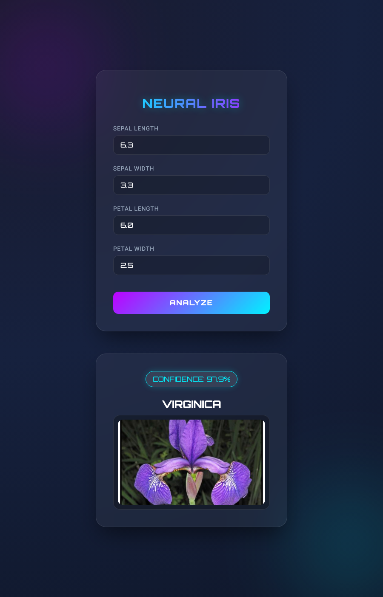

# Docker Lab 2: Training and Serving an Iris Classifier

This lab trains a small TensorFlow model on the Iris dataset and serves it through a Flask web app, packaged two ways:

1. **Multi-stage `dockerfile`**: stage 1 trains the model, stage 2 copies only the trained model into a serving image.
2. **`docker-compose.yml`**: a trainer container writes the model into a shared volume, and a serving container reads it from there once training finishes.

## How to Run

**Option A: dockerfile**
```bash
docker build -t iris-app .
docker run -d --name iris -p 8080:80 iris-app
# open http://localhost:8080/predict
```

**Option B: docker compose**
```bash
docker compose up -d              # serves on http://localhost/predict
HOST_PORT=8080 docker compose up -d   # if port 80 is already in use
docker compose down -v
```

**Test either one**
```bash
./tests/smoke_test.sh http://localhost:8080
```

### Endpoints

| Method | Path | What it does |
|---|---|---|
| GET | `/` | Welcome message |
| GET | `/health` | Status plus the loaded model's training metrics (used by the healthcheck) |
| GET | `/predict` | Web form |
| POST | `/predict` | Prediction from form data or JSON; returns class, confidence and all three probabilities |

```bash
curl -X POST localhost:8080/predict -H 'Content-Type: application/json' \
     -d '{"sepal_length": 6.3, "sepal_width": 3.3, "petal_length": 6.0, "petal_width": 2.5}'
# {"confidence":0.9789,"predicted_class":"Virginica","probabilities":{"Setosa":0.0,"Versicolor":0.0211,"Virginica":0.9789}}
```

## My Changes

### Bugs fixed

I built and ran the original lab first to get a baseline ([proofs/04_before_vs_after.txt](proofs/04_before_vs_after.txt)). It had two bugs that stopped it from working:

- **The server couldn't be reached.** Flask listened on port 4000, but the dockerfile `EXPOSE`d 80 and compose mapped `80:80`, so nothing answered on the documented port. The app now reads a `PORT` environment variable that defaults to 80.
- **Almost every prediction was "Virginica".** Training standardized the inputs with a `StandardScaler`, but the scaler was never saved, so the server fed raw centimetre values to a model trained on scaled values. The original image got only 2 of 6 known flowers right. I replaced the scaler with a Keras `Normalization` layer inside the model, so the saved `.keras` file does its own scaling. The fixed image gets 6 of 6.

### Dockerfile
- Switched to `python:3.10-slim` and split the requirements so the serving image skips scikit-learn. **The image dropped from 4.15 GB to 1.84 GB.**
- Copied the requirements files and ran `pip install` *before* copying the code, so a code change doesn't reinstall TensorFlow ([layer cache proof](proofs/07_rebuild_layer_cache.txt)).
- Added a `HEALTHCHECK` that calls `/health`, so `docker ps` shows `(healthy)`.
- The container runs as a non-root user (`appuser`) instead of root.
- The container now serves with `gunicorn` instead of Flask's development server, and debug mode is off. Debug mode lets anyone who can reach the port run code on the server.
- Added a `.dockerignore` so proofs, tests and docs stay out of the build context.

### docker-compose.yml
- Training writes the model straight into the shared volume (`MODEL_DIR=/exchange`), and serving reads it from there (`MODEL_PATH`). This replaced the `cp` steps. The serving container mounts the volume read-only.
- Added a healthcheck, `restart: unless-stopped`, a `pip_cache` volume so packages download once, and a configurable `HOST_PORT`.

### Model training
- Fixed random seeds so every build trains the same model. Both runs gave exactly 93.33% test accuracy.
- The test set is used only once at the end. Validation now comes from a split of the training data, and early stopping watches validation loss.
- Stratified train/test split, and a slightly larger network (16 → 8 → 3).
- Writes `metrics.json` (accuracy, loss, epochs, timestamp), which `/health` reports.

### Flask app and UI
- Accepts JSON bodies as well as form data.
- Validates input. Missing, non-numeric or out-of-range values return HTTP 400 with a clear message instead of a 200 with an error inside.
- Returns confidence and all three class probabilities. The UI badge shows the real confidence instead of a hardcoded "CONFIDENCE: HIGH".
- Pinned every dependency version.

### Tests
- `tests/smoke_test.sh` runs 13 checks: every endpoint, six known flowers (two per class), a JSON request, and three kinds of bad input.

## Proofs

Everything below was run on an Apple Silicon Mac (Docker 29.5 via Colima, linux/arm64).

| # | File | Shows |
|---|---|---|
| 1 | [01_docker_build.log](proofs/01_docker_build.log) | Full multi-stage build, including training output (`Test accuracy: 0.9333`) |
| 2 | [02_container_running.txt](proofs/02_container_running.txt) | `docker ps` showing `(healthy)`, `/health` output, container running as `uid=1000(appuser)` |
| 3 | [03_smoke_test_dockerfile.txt](proofs/03_smoke_test_dockerfile.txt) | 13/13 smoke tests pass against the dockerfile image |
| 4 | [04_before_vs_after.txt](proofs/04_before_vs_after.txt) | Original vs fixed: port bug, 2/6 vs 6/6 predictions, 4.15 GB vs 1.84 GB |
| 5 | [05_ui_prediction_setosa.png](proofs/05_ui_prediction_setosa.png) | Web UI predicting Setosa (99.4%) |
| 6 | [06_ui_prediction_virginica.png](proofs/06_ui_prediction_virginica.png) | Web UI predicting Virginica (97.9%) |
| 7 | [07_rebuild_layer_cache.txt](proofs/07_rebuild_layer_cache.txt) | Rebuild with every step taken from the cache |
| 8 | [08_compose_up.log](proofs/08_compose_up.log) | `docker compose up` output |
| 9 | [09_compose_running.txt](proofs/09_compose_running.txt) | Trainer exited 0, server healthy, model files in the shared volume |
| 10 | [10_smoke_test_compose.txt](proofs/10_smoke_test_compose.txt) | 13/13 smoke tests pass against the compose stack |

**Before vs after (same 6 flowers):**
```
               original lab        fixed
Setosa     ->  Virginica  ✗        Setosa      (99.4%)
Setosa     ->  Virginica  ✗        Setosa      (99.5%)
Versicolor ->  Virginica  ✗        Versicolor  (65.6%)
Versicolor ->  Virginica  ✗        Versicolor  (59.5%)
Virginica  ->  Virginica  ✓        Virginica   (96.0%)
Virginica  ->  Virginica  ✓        Virginica   (97.9%)
```



## Reflection

**What I learned.** The main thing I learned is that "it runs" doesn't mean "it works." The original lab built fine and the container started, but when I tested it with real flowers it said "Virginica" almost every time. The reason was that the training code scaled the inputs, but that scaling step never made it to the server. So the model was getting different kinds of numbers than it was trained on. I fixed it by putting the scaling inside the model, so it can't get lost anymore.

The port problem surprised me too. I thought `EXPOSE 80` made the app run on port 80, but it doesn't. It's basically just a note. The app was actually running on port 4000, so nothing answered on port 80. Now I know the app's port, the `EXPOSE` line and the `-p` mapping all need to match.

**Dockerfile vs docker compose.** Both ways separate training from serving, but they do it differently. The Dockerfile trains the model while the image is being built, so the finished image already has the model inside and can run anywhere. Docker compose trains the model when you start it, and passes the model to the server through a shared volume. Compose felt more like a real pipeline, but it reinstalls everything and retrains every time you run `docker compose up`. If I had to deploy this, I'd pick the Dockerfile. For testing changes to the training code, compose is easier.

**Making the image smaller and faster.** Switching to the `slim` Python image and not installing scikit-learn in the serving stage made the image go from 4.15 GB to 1.84 GB. I also learned that the order of steps in a Dockerfile matters. Installing packages before copying the code means Docker can reuse the saved packages when I only change code, so rebuilding takes seconds instead of downloading TensorFlow again. Most of the 1.84 GB left is TensorFlow itself.

**What could be better.**
- The model gets Versicolor right but is only about 60% sure. Versicolor and Virginica look a lot alike in the data, so it's harder to tell them apart. Training longer might help.
- In docker compose, the server still installs packages every time it starts, which is slow.
- Next time I'd add GitHub Actions (like in GitHub Lab 1) to build the image and run the tests automatically on every push.
